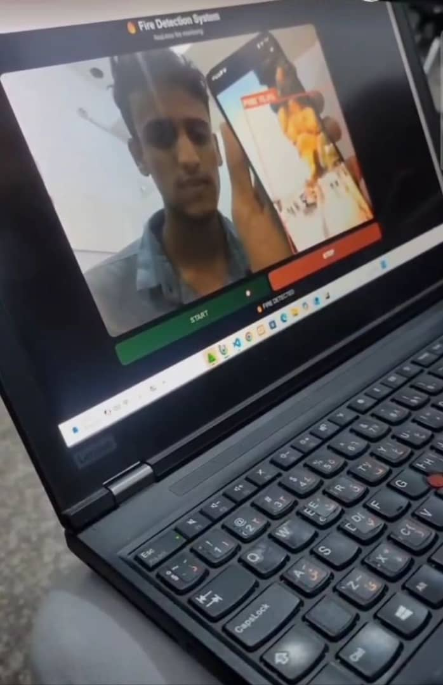
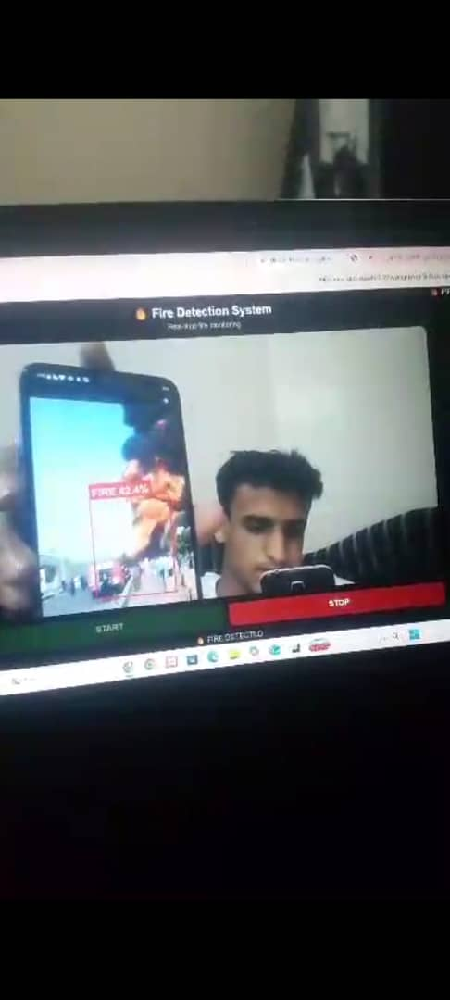
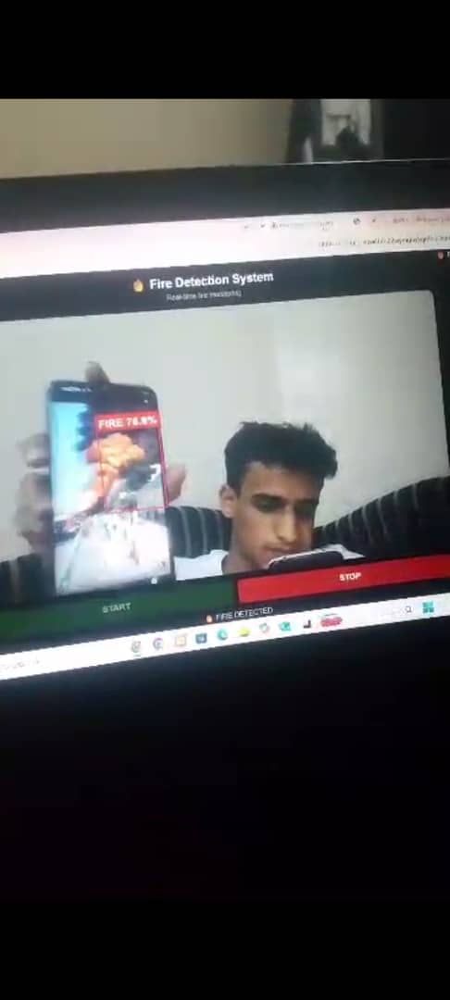
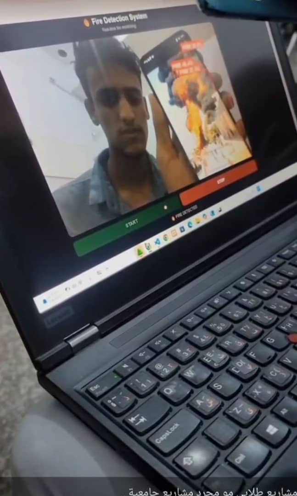

🔥 Fire & Smoke Detection Using YOLO26

An AI-Powered Computer Vision System for Detecting Fire and Smoke

A computer vision project that explores automated fire and smoke detection using deep learning and the YOLO object detection framework. The system identifies visible fire and smoke in images and explores camera-based monitoring through a real-time detection interface.

The project covers dataset preparation, annotation quality analysis, model training, quantitative evaluation, and visual detection results.

Project Focus: Computer Vision · Deep Learning · Object Detection · AI for Safety

---

📌 Table of Contents

- "Project Overview" (#-project-overview)
- "The Problem" (#-the-problem)
- "Project Objectives" (#-project-objectives)
- "Visual Results" (#-visual-results)
- "Key Features" (#-key-features)
- "How It Works" (#-how-it-works)
- "Dataset" (#-dataset)
- "Model Evaluation" (#-model-evaluation)
- "Technologies Used" (#-technologies-used)
- "Training Workflow" (#-training-workflow)
- "Current Repository Structure" (#-current-repository-structure)
- "Limitations and Future Improvements" (#-limitations-and-future-improvements)
- "Safety Disclaimer" (#-safety-disclaimer)
- "Author" (#-author)

---

🎯 Project Overview

Fire and smoke detection is an important computer vision application with potential uses in building monitoring, industrial environments, warehouses, and other locations where early awareness of visible hazards matters.

This project uses a YOLO-based object detection model trained to recognize two classes:

- Fire
- Smoke

Instead of simply classifying an entire image as dangerous or safe, an object detection model predicts the locations of recognized objects using bounding boxes and confidence scores.

The project also explores a browser-based camera monitoring interface to demonstrate how model predictions can be presented to a user.

The primary objective is to build practical experience across the machine learning lifecycle, from dataset inspection and model training to evaluation and visual demonstration.

🚨 The Problem

Fire and smoke can appear in different shapes, sizes, backgrounds, and lighting conditions. Detecting them automatically is challenging because:

- Smoke may have weak boundaries and resemble clouds, fog, or other background patterns.
- Fire may appear differently depending on its size, distance, and surrounding environment.
- Lighting conditions and camera quality can affect visual predictions.
- False positives may trigger unnecessary alerts.
- Missed detections can reduce the usefulness of a monitoring system.

Computer vision provides an approach for analyzing visual information and identifying patterns associated with fire and smoke.

However, model predictions must be evaluated carefully before such a system can be considered for real-world safety applications.

🎯 Project Objectives

The project aims to:

1. Develop a YOLO-based model for detecting fire and smoke.
2. Prepare and inspect an object detection dataset.
3. Examine dataset structure and annotation quality.
4. Evaluate model performance using standard object detection metrics.
5. Analyze performance separately for fire and smoke.
6. Present predictions through visual detection outputs.
7. Explore a camera-based monitoring interface.
8. Identify limitations and opportunities for further improvement.

---

🖼️ Visual Results

The following images showcase the project's visual outputs.

Detection Results

  

  <em>Figure 1. Fire detection visualization.</em>

  

  <em>Figure 2. Additional fire detection example.</em>

  

  <em>Figure 3. Additional visual detection output.</em>

Fire and Smoke Detection

  

  <em>Figure 4. Fire and smoke detection visualization.</em>

«Note: These images are visual examples, not a substitute for a comprehensive evaluation across different environments.»

---

✨ Key Features

🔥 Dual-Class Object Detection

The model is trained to detect two target classes:

- Fire
- Smoke

📦 Bounding-Box Predictions

The object detection pipeline identifies candidate regions and represents detections using bounding boxes and confidence scores.

🔍 Dataset Quality Analysis

The development workflow includes checks related to image-label pairing, annotations, and object characteristics.

📊 Quantitative Evaluation

The model is evaluated using precision, recall, and mean Average Precision at different IoU thresholds.

🎥 Camera Monitoring Interface

The notebook includes a browser-based camera monitoring interface designed to present the camera feed and visual detection information.

🧪 Error Analysis

Evaluation outputs can help identify missed detections, false positives, and differences in performance between fire and smoke.

---

⚙️ How It Works

The system follows a typical object detection workflow.

1. Input Preparation

Images are organized into dataset splits and paired with their corresponding object detection annotations.

2. Dataset Inspection

The data preparation workflow checks image-label relationships and examines annotation characteristics to identify potential dataset issues.

3. Model Training

A YOLO-based object detection model is trained to predict the locations of fire and smoke.

4. Inference

An input image or camera frame is processed by the trained model.

The model produces predictions containing:

- Predicted class
- Bounding-box coordinates
- Confidence score

5. Visualization

The predictions can be displayed over the input image or camera feed to make the detected regions easier to inspect.

6. Evaluation

Predictions are evaluated against annotated ground-truth objects using standard object detection metrics.

---

🗂️ Dataset

The training workflow uses a fire and smoke detection dataset obtained through KaggleHub.

Dataset identifier: "sayedgamal99/smoke-fire-detection-yolo"

The target classes used in the notebook are:

Class ID| Class Name
0| Smoke
1| Fire

The dataset workflow uses training, validation, and test directories.

These splits serve different purposes:

- Training set: Used to optimize model parameters.
- Validation set: Used to monitor performance during development.
- Test set: Used for final evaluation after model development.

Data Quality Checks

The notebook includes data inspection steps covering:

- Image and label pairing
- Annotation checks
- Object-size analysis
- Dataset structure
- Detection error analysis

Dataset quality matters because missing labels, incorrect bounding boxes, and unrepresentative samples can affect model training and evaluation.

Dataset source: "Kaggle — Smoke and Fire Detection YOLO Dataset" (https://www.kaggle.com/datasets/sayedgamal99/smoke-fire-detection-yolo)

---

📊 Model Evaluation

The notebook reports the following aggregate evaluation results.

Metric| Score
Precision| 76.6%
Recall| 70.0%
mAP@50| 76.7%
mAP@50–95| 43.8%

What Do These Metrics Mean?

Precision

Measures how many predicted detections are correct. Higher precision generally means fewer false-positive detections.

Recall

Measures how many ground-truth objects are successfully detected. Higher recall generally means fewer missed objects.

mAP@50

Mean Average Precision calculated at an Intersection over Union (IoU) threshold of 0.50.

mAP@50–95

Mean Average Precision averaged across IoU thresholds from 0.50 to 0.95. This provides a stricter assessment of detection and localization quality.

Per-Class Performance

The notebook reports the following class-specific results:

Class| Precision| Recall| mAP@50| mAP@50–95
Smoke| 81.6%| 76.5%| 82.4%| 50.5%
Fire| 71.5%| 63.5%| 71.1%| 37.2%

Interpretation

The reported results show stronger performance on smoke than on fire across the listed metrics.

The difference suggests that further investigation may be useful, particularly for fire detection recall and localization accuracy.

Potential areas to investigate include:

- Hard examples and missed detections
- False-positive patterns
- Small or distant objects
- Differences in visual conditions
- Dataset representation and annotation quality
- Confidence-threshold selection

These results should be interpreted in the context of the dataset and evaluation procedure. They do not establish performance in every real-world environment.

---

🛠️ Technologies Used

Technology| Purpose
Python| Main programming language
YOLO / Ultralytics| Object detection and model training
PyTorch| Deep learning framework
OpenCV| Computer vision operations
KaggleHub| Dataset retrieval
Google Colab| Notebook development and experimentation
HTML, CSS, JavaScript| Browser-based monitoring interface

---

🧠 Training Workflow

The notebook follows a machine learning workflow that includes:

1. Dataset retrieval.
2. Dataset structure inspection.
3. Image and annotation checks.
4. Model configuration and training.
5. Validation and performance monitoring.
6. Evaluation on the configured test data.
7. Class-level metric analysis.
8. Error analysis.
9. Visual prediction and camera-interface experimentation.

The trained model checkpoint is saved during the notebook workflow at:

"/content/runs/fire_smoke_final/weights/best.pt"

This path belongs to the notebook's execution environment. It is not a downloadable model link, and the checkpoint is not currently listed among the files in this GitHub repository.

Reproducibility

The repository currently contains the README and visual assets. The notebook, dependency lockfile, and trained model weights are not included in the visible repository structure.

Consequently, reproducing the training process from a fresh repository clone requires the original notebook, its dependencies, and access to the dataset.

---

📁 Current Repository Structure

fire-smoke-detection-yolo/
│
├── assets/
│   ├── fire_detection.jpeg
│   ├── fire_detection2.jpeg
│   ├── fire_detection3.jpeg
│   └── fire_smoke_detection.jpeg
│
└── README.md

The "assets/" directory stores the images displayed in this documentation.

---

🚀 Limitations and Future Improvements

This project is an experimental computer vision prototype. Several areas could be developed further.

1. Improve Fire Detection Recall

Investigate missed fire detections and experiment with training strategies, confidence thresholds, and additional representative samples.

2. Evaluate More Challenging Conditions

Test the model on diverse lighting conditions, distant objects, partially obscured hazards, and visually confusing backgrounds.

3. Reduce False Positives

Analyze false-positive predictions and evaluate methods for distinguishing actual hazards from visually similar objects.

4. Expand Error Analysis

Organize errors by class, object size, confidence score, and environmental conditions.

5. Improve Real-Time Monitoring

Measure latency and processing throughput on clearly documented hardware, then assess the monitoring interface under realistic camera conditions.

6. Strengthen Reproducibility

Add the original notebook, a dependency file, clear setup instructions, and a documented way to obtain the trained model.

7. Validate Before Deployment

Conduct independent testing under representative real-world conditions before considering any operational use.

---

⚠️ Safety Disclaimer

This project is intended for educational, research, and prototyping purposes.

It is not a certified fire alarm, life-safety system, or replacement for approved smoke detectors, fire alarms, or professional emergency systems.

Model predictions may include false positives and false negatives. The reported dataset metrics do not guarantee reliable detection in real-world environments.

Any real-world safety deployment would require rigorous independent validation, appropriate certified equipment, human oversight, and compliance with applicable safety requirements.

---

👨‍💻 Author

Esmail Emrany

AI and Data Science Student | Machine Learning | Computer Vision

Interested in building practical AI systems that address real-world problems.

- GitHub: "@esmailemrany" (https://github.com/esmailemrany)
- Project Repository: "Fire & Smoke Detection Using YOLO26" (https://github.com/esmailemrany/fire-smoke-detection-yolo)

---

  <strong>Building practical AI solutions through experimentation, evaluation, and continuous improvement.</strong>

